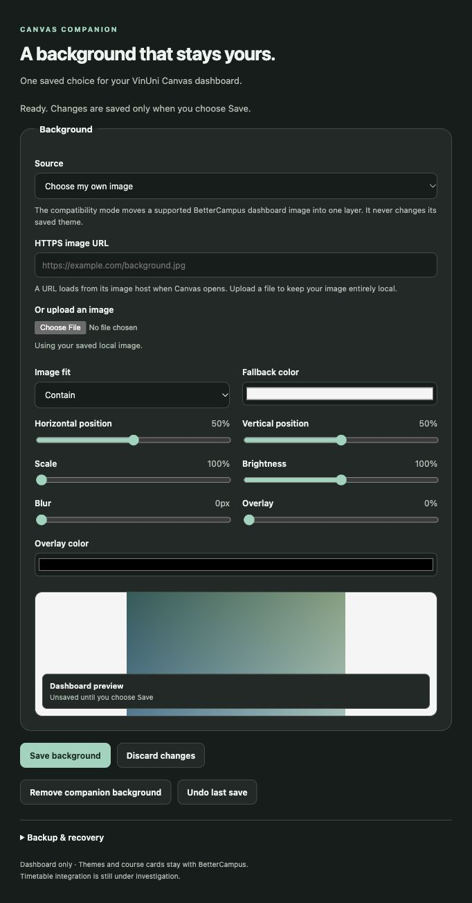

# Canvas Companion

A small Manifest V3 companion for the VinUni Canvas dashboard, designed to coexist with BetterCampus. This is an independent project, not a modified or official BetterCampus release.

The first increment addresses background consistency. Timetable development remains behind an explicit planner interoperability gate so it does not silently create a second academic system.

## Backgrounds

- Reversible compatibility mode moves a supported BetterCampus dashboard image into one rendering layer, including its gradient overlay and image filter.
- Custom HTTPS image URLs or local uploads, with cover/contain, positioning, scale, brightness, blur, overlay, fallback color and preview.
- One canonical configuration per university dashboard scope. Uploaded bytes are addressed by SHA-256 and reused.
- Transactional persistence and revision checks prevent stale settings windows from overwriting a newer choice.
- Removal, one-step undo, and checksum-validated backup import/export.
- No runtime dependencies, telemetry, vendor uploads, Canvas API calls or academic writes in this increment.

The companion cannot read or migrate another extension's private storage. Original BetterCampus settings stay with BetterCampus. Compatibility mode reads only supported rendered theme CSS; ambiguous multiple-image backgrounds are left alone.

## Install and verify

See [installation and rollback](docs/INSTALL.md). Load the generated unpacked folder after reviewing the code and the narrow Canvas permission. The reviewed 0.1.0 build was installed in the university Chrome profile with explicit user approval. A new installation still requires reviewing and granting the stated access. Keep Developer mode enabled for the unpacked build; this Chrome installation disables it when Developer mode is off.

```sh
npm test
npm run check
npm run package
```

Node 22 or newer is required for development checks; no dependency installation is needed. Load `dist/canvas-companion-0.1.0` in Chrome for a local trial. The repository also contains [browser fixtures](tests/browser/index.html), [architecture](docs/ARCHITECTURE.md), [audit findings](docs/AUDIT.md), [test evidence](docs/TESTING.md), and the [roadmap](docs/ROADMAP.md).

## Verification status

Eight model tests and 19 real-browser fixture checks pass. The actual settings UI was exercised with a synthetic local image through save, reload, remove and undo; a 360-pixel viewport had no horizontal overflow. Browser fixture storage is separate from Chrome extension storage.

The unpacked extension was also tested on authenticated Canvas: upload/save, refresh, an open-tab visual update, course navigation, BetterCampus theme coexistence, removal/undo, image failure, and Chrome restart persistence passed. See [live validation](docs/LIVE-VALIDATION.md) for exact evidence and limitations. Exhaustive theme/layout regression coverage remains open. The timetable, examinations, projects and reminders are not implemented in this release.



## Data and privacy

The only host permission is `https://vinuni.instructure.com/*`; only dashboard paths receive background rendering. Images uploaded through the companion remain in its extension-origin IndexedDB. URL images load from the chosen host. Backups contain private settings and possibly an image; do not commit them. Browser profile loss, uninstall or explicit data clearing can remove local data, so export backups before those operations.

The full local investigation and personal environment paths are excluded from Git. Published documentation and screenshots use synthetic information only.
