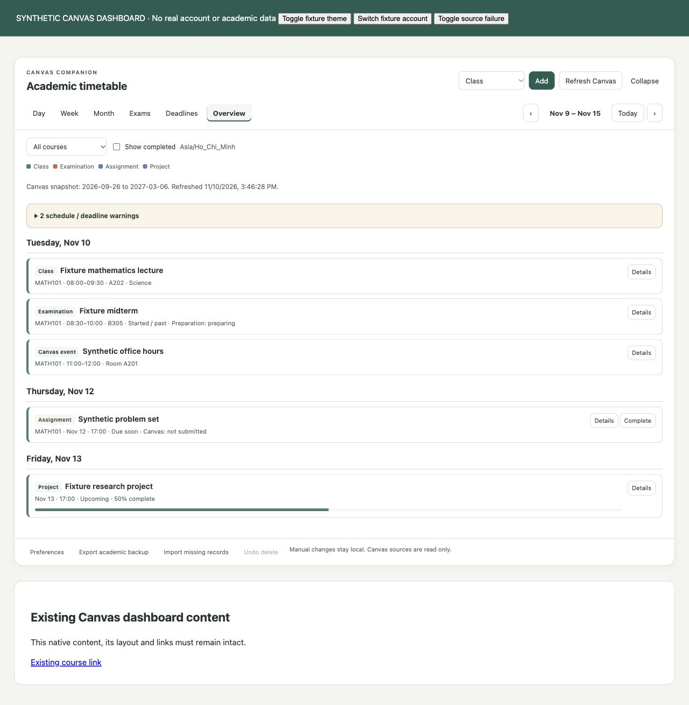
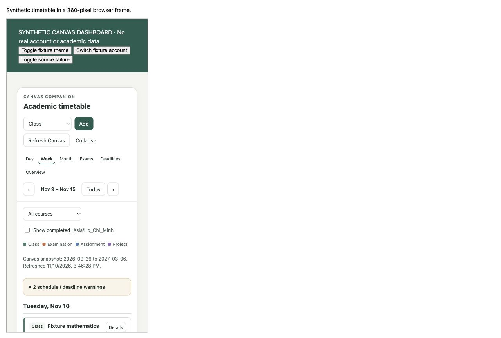

# Timetable implementation and validation — 0.2.0

Date: 10 November 2026. The user explicitly approved companion ownership of manual academic records and the installed extension trial. This report separates synthetic tests from live university Canvas observations. Published fixtures and screenshots contain synthetic information only.

## Stages and affected files

| Stage | Investigation/discovery | Changes and files | Verification / remaining limits |
| --- | --- | --- | --- |
| Audit (previous increment) | Only the installed BetterCampus package was available; matching source/private planner contract was unavailable. Background rendering could apply the same unfiltered image to multiple shell surfaces. | Existing `docs/AUDIT.md`, background architecture and private ignored audit. | Original repeated wallpaper was not reproduced; the renderer cause remains a bounded diagnosis, not proof of duplicate saved vendor records. |
| Background diagnosis/implementation (previous increment) | Canonical companion configuration and one renderer could be introduced without modifying vendor private settings. | Existing background model/repository/renderer, settings and worker. | Eight original Node tests, 19 browser fixtures and the historical installed trial, including Chrome restart. |
| Timetable architecture/approval | Vendor-only manual planner entries cannot be read through an assumed public API. User separately approved the companion as manual timetable owner. | `docs/PLANNER-INTEGRATION.md`, `docs/TIMETABLE-ARCHITECTURE.md`; no private vendor migration. | Existing vendor-only entries require deliberate supported transfer. |
| Incremental implementation | One account-scoped manual store and canonical source identities support all views. | `src/academic/*`, `src/storage/database.js`, worker/content lifecycle, additive background repository opener, manifest/package/check script, settings footer. | No dependencies or permissions added. API adapter is same-origin GET-only. |
| Functional verification/fixes | Tests exposed boundary/time issues and UI reload/contrast issues. | Node/browser tests, fixtures and fixes described below. | Measured results below; no claim of exhaustive compatibility. |
| Release report | Documents ownership, storage, recovery, usage, rollout and remaining work. | README; architecture, install, planner, roadmap, testing and new timetable documents; synthetic screenshots/results. | Private backups, user images and live university screenshots remain excluded from Git. |

## Automated and synthetic browser checks

| Check | Observed result |
| --- | --- |
| Node correctness/regression tests | 33 passed: 25 academic tests plus 8 existing background tests |
| Manifest, allowed host/permissions, source API restrictions and JavaScript syntax | Passed; 26 JavaScript files checked |
| Existing real-browser background suite after database refactor | 19/19 passed |
| Real-browser academic IndexedDB/migration suite | 14/14 passed; [machine-readable results](academic-browser-results.json) |
| Actual timetable UI through fixture worker transport | Created class, saved exam, saved project/milestone/task, created/completed manual assignment; verified project 50% progress |
| Recurring class edit/delete/undo | Room edit shown; deletion removed series; undo restored it |
| Views/navigation | Day, week, month, exam calendar, deadline calendar and overview exercised; next week displayed next recurrence; previous returned to current week; monthly and filtered calendars had 42 cells |
| Warnings | Class/exam overlap and approaching-deadline warning displayed using synthetic events |
| Account switch | Other fixture account showed an empty timetable; switching back restored original records |
| Source failure | Error displayed while existing imported assignment remained visible |
| Refresh persistence | Saved class, exam, project/tasks and personal completion remained after fixture page reload |
| Theme tokens | Light/dark surfaces rendered; dark primary button measured light green background with near-black text |
| Narrow browser context | Real 360-pixel iframe reported client width 360 and scroll width 360; weekly layout used readable agenda cards |
| Native content preservation | Existing fixture content/link remained alongside the injected timetable |

The academic browser suite uses a random temporary database. It starts with a real version-1 background record and exact synthetic Blob bytes, upgrades to version 2, exercises manual CRUD, simultaneous stale-edit rejection, account partitioning, delete recovery, repeated source refresh and moved deadlines, annotation identity, manual/import duplicate prevention, exam/project persistence, account-bound idempotent backups, fresh-scope preference recovery, failed-snapshot preservation, and unchanged background bytes. It then deletes its own temporary fixture database.

UI fixtures use the actual modules and worker with a mock Chrome transport and a synthetic Canvas reader. They prove browser/IndexedDB/UI behavior under that environment, not the real Canvas response schema by themselves. The browser viewport override did not change the existing IAB viewport; responsive evidence therefore comes from a real 360-pixel iframe, not a claimed top-level resize.

## Installed Chrome / authenticated Canvas observations

The existing unpacked folder path and extension ID were retained. A private background export and previous code copy were saved locally before updating; the export was not committed or uploaded.

- Chrome loaded version 0.2.0 with the existing university-only permission and extension identity.
- A SHA-256 fingerprint over the complete companion background snapshot matched exactly before/after upgrade. The saved local image, controls and revision were unchanged.
- The new academic section connected to the signed-in account and showed its empty state before import.
- **Refresh Canvas** produced a successful source snapshot. Its coverage/refresh label persisted after dashboard refresh. No academic write action was performed.
- A clearly labeled disposable manual class was created using the live UI, edited (room and recurring term end), and refreshed. Details showed the edited room and term end persisted.
- The disposable class was deleted through the reversible UI. Final read-only inspection of the companion's own stores showed zero active manual records and one deleted validation record; Undo remains available. No user timetable record was removed.
- Read-only companion storage counts showed one background record, one image asset and one source-cache scope. Every source key was unique. No source titles, grades, account identifiers or raw academic payloads were written into this report.
- Live DOM inspection showed one timetable, one ready background layer and native Canvas content present. Existing Canvas content remained accessible below the section.

Live import success was established by the persisted snapshot, not the transient success message, which can be replaced by a revision-triggered reread. The final package also uses compact agenda cards for weeks with deadlines but no timed meetings.

## Corrections made during verification

- Primary-button hover no longer replaces the accent background while retaining white text. Foreground is chosen for accent luminance; error/deadline colors adapt to theme text.
- Refresh controls rerender after clearing the busy state. Concurrent saves display an error rather than silently closing an unsaved form.
- All source annotations use one deterministic identity. Origin-wide Canvas assignment identity remains stable when a wrapper omits course metadata; manual entries/backups cannot create another task from a Canvas assignment link.
- Overnight recurrence projection includes meetings that begin before the displayed day. A project deadline near local midnight is compared to its local start date, not a UTC date fragment.
- Explicitly absent Canvas deadlines stay undated. All-day calendar dates and events without a positive duration remain visible without inventing class times.
- Account changes hide/reset the previous view and close editors; mutation/export rechecks account identity.
- Chrome retained a historical error from the old build's invalidated-context cleanup. Cleanup now guards unavailable extension storage APIs, and orphaned navigation timers stop when the extension context is gone. The historical log was not erased to manufacture a clean result.

## Limits and follow-up

- Browser restart persistence was demonstrated for background version 0.1.0; a full restart was not repeated for the new timetable. Version-2 background byte preservation, reopened repositories and live refresh persistence were tested.
- Live exam/project CRUD and every warning combination were not repeated with real university data; synthetic UI/logic/storage checks cover those paths.
- The exact original BetterCampus wallpaper, all vendor themes/layouts/planner states, hidden-tab delivery independent of focus, quota exhaustion, suspended-worker stress and large-data performance remain unverified. BetterCampus's prior enabled/disabled state and saved customizations were not changed in this update.
- Keyboard labels, native dialogs, focus styles and responsive behavior were exercised; this is not formal screen-reader/contrast certification.
- Canvas may omit schedules/rooms/exams. No missing facts are invented. BetterCampus-only records do not automatically synchronize.
- No desktop reminder service, external calendar synchronization or cross-device storage in this release. These remain explicit roadmap items.

