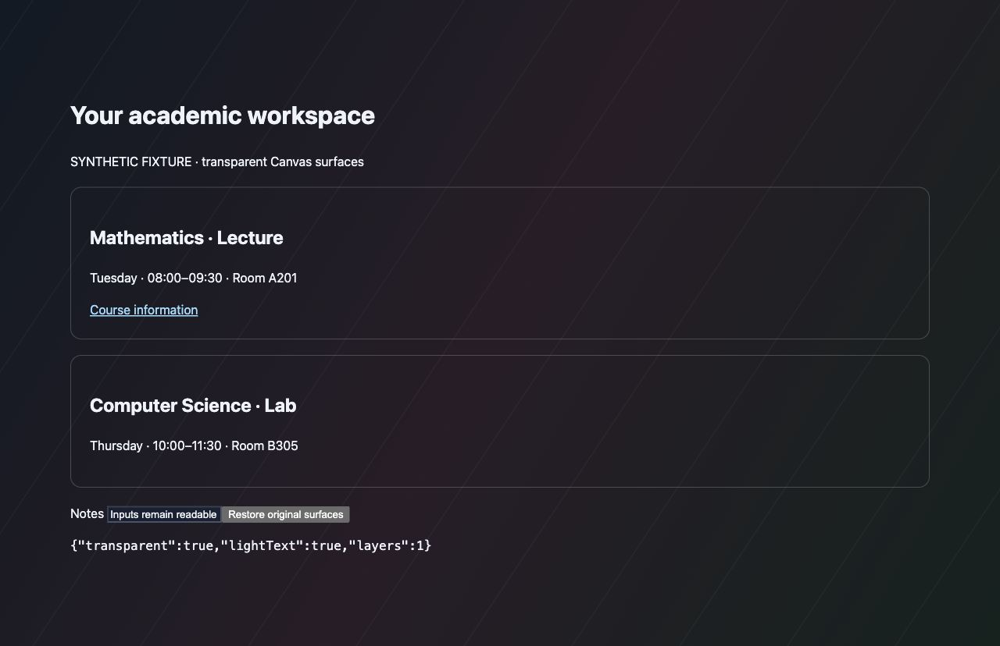

# Transparent Canvas appearance — 0.3.0

Requested change: make opaque white Canvas surfaces transparent, keep the current local image/black overlay, use light text and editor-like accents, and extend coverage beyond the dashboard.

## Implementation

The existing background record gains validated optional `appearance.pages` (`dashboard` / `all`) and `appearance.surface` (`original` / `transparent`) values. Old records default to their previous dashboard-only/original appearance. The existing scope key is retained as a compatibility identifier; extending page coverage does not create another record or image asset. No database upgrade or new host permission is required.

The settings interface exposes both options. When enabled, the renderer clears supported Canvas shell, card, table and InstUI view backgrounds and supplies light text, blue links, dark readable controls and inherited timetable tokens. It reuses the existing single image layer, image position, filters and overlay. Clearing/disabling the companion removes its ownership attributes/styles and restores the original cascade. An unavailable image uses a dark fallback in transparent mode to preserve light-text readability.

Embedded cross-origin documents, PDFs and rich text editor documents keep their own readable surfaces. Canvas/vendor selector changes and arbitrary course-authored HTML can require further compatibility work; no claim is made that every embedded white document can be made transparent.

A floating Timetable shortcut links to the existing dashboard section rather than mounting duplicate timetable applications on every course page.

## Schedule support

Manual meetings now distinguish lecture, lab, tutorial, seminar and other sessions. Selected teaching dates and skipped dates can be applied per meeting, allowing a course's lectures and labs to follow different teaching weeks. Office hours and events are independent one-time record types; their end time may remain unknown. Examinations still require a positive known duration. Appointment-only hours remain notes until an appointment is known.

Private registered schedules/source summaries and recovery exports are excluded from Git. The generic extension never scrapes personal portal pages automatically or adds a portal host permission. Registration and academic records remain read-only; deliberate companion imports add manual records by stable identity and preserve existing annotations.

## Measured checks

- 38 Node tests passed, including all-page scope, lecture/lab identity, per-meeting dates/cancellations and unknown office-hour duration.
- Existing browser suites: 19 background checks and 14 academic storage/migration checks passed after the changes.
- Synthetic transparent fixture: card background computed transparent; heading computed light text; one image layer. Clearing restored the original white card and removed the layer.
- Installed settings: All Canvas pages and Transparent options were saved through the UI while preserving the existing local image and black overlay.
- Live DOM checks passed on the dashboard and a course home: one ready background layer, transparent appearance, shortcut present; final dashboard white-panel count zero and timetable shell computed rgba(0,0,0,0). The exam view showed 42 calendar cells and five examinations in its November window. A reviewed private schedule import persisted after refresh, with all previous personal annotations unchanged and no duplicate identities. Image bytes and all existing visual controls matched the pre-update backup; one configuration and one asset remained. No exhaustive theme/iframe/quiz/editor compatibility certification is claimed. The timetable uses dedicated companion surface tokens so styling does not mask legacy BetterCampus image variables.

Live screenshot emission was blocked by automatic approval review to avoid exposing private academic content. Verification used DOM/status/color measurements and the synthetic preview instead. This is a limitation on published visual evidence, not a claim that private screenshots were shared.
